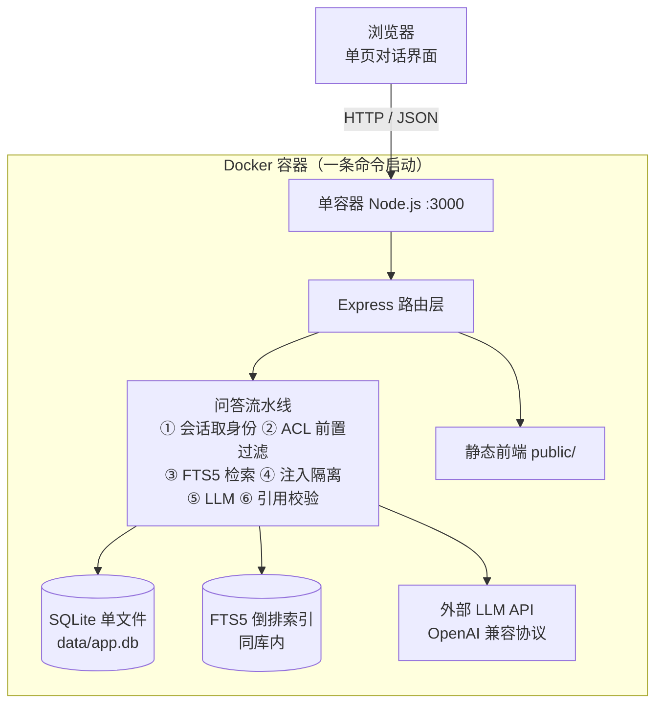

# Q1「项目资料助手」系统架构设计

> **文档定位**：本文是 Q1 的系统架构基线，给出技术选型、数据库设计、后端分层、部署方案与验收映射。
> **需求基线**：`Q1-设计/PRD-需求分析与设计.md`（流程图 §3、接口契约 §4、测试矩阵 §6）。
> **脚手架实现**：`q1-assistant/`，公共层已落代码，业务层为占位；开发规范见 `.codebuddy/rules/SCAFFOLD.md`。

---

## 1. 设计原则

1. **少而对**：32 份文档、预期 4–6 小时。拒绝向量库、独立数据库服务、前端构建链、登录体系。
2. **一条命令启动**：Docker Compose 单容器，数据落在单文件 SQLite。
3. **安全边界在服务端**：身份存服务端会话；权限过滤写在检索 SQL 里，越权文档**物理上无法**进入召回结果，而不是靠提示词约束。
4. **公共能力只写一次**：config / db / 响应 / 校验 / 模型工厂 / ACL / 注入防护全部沉淀为公共模块，业务代码只做串联，不写冗余实现。

---

## 2. 架构总览



**关键点**：ACL 过滤与检索在**同一条 SQL** 里完成（见 §4.4），不是"先全量召回再过滤"，杜绝越权文档的内容或存在性泄露。

---

## 3. 技术选型

| 层 | 选型 | 理由 | 明确不选 |
|---|---|---|---|
| 前端 | 原生 HTML/CSS/JS（在 `prototype.html` 上扩展） | 零构建、零依赖，Express 静态托管；题目 UI 不加分 | React/Vue + 打包器 |
| 后端 | Node.js 20 + Express（ESM，无 TS 编译） | 与前端同语言、生态轻、冷启动快 | Spring Boot / Django |
| 数据库 | **SQLite**（`better-sqlite3`），单文件 | 嵌入式、零运维、随容器一键起；32 份文档足够 | PostgreSQL/MySQL（多一个服务）、向量库 |
| 检索 | SQLite **FTS5** + 中文 2-gram 预切分 + `bm25()` 排序 | 倒排索引持久化在库内、自带 BM25，不手写索引结构 | 独立 Elasticsearch / 向量检索 |
| LLM | **LangChain 1.3.1 JS**：`langchain@1.3.1` + `@langchain/core@1.3.1` + `@langchain/openai@~1.3.0` + `zod` | 统一模型接口与结构化输出；DeepSeek/豆包/OpenAI 均为 OpenAI 兼容协议，一个 `ChatOpenAI` 搞定 | 每厂商装独立 provider；浏览器直连 LLM（泄露 Key） |
| 会话 | SQLite `sessions` 表 + `httpOnly` Cookie | 身份只在服务端；请求体里的 `clientId` 一律忽略 | 无状态 JWT、信任前端传身份 |
| 部署 | Docker Compose 单容器 + 数据卷 | 一条命令、可复现、Key 用 env 注入 | K8s、多服务编排 |

> LangChain 以 npm bundle 方式在 Docker 构建时 `npm ci` 打进镜像，API Key 只在服务端容器内，前端拿不到。

---

## 4. 数据库设计

只建 1 个库、8 张表（含 1 张 FTS5 虚表）。`access.json` 是 seeding 输入，灌库后 `document_acl` 成为权限唯一权威源——符合 PRD「禁止硬编码哪些文档敏感，换一批数据仍生效」。

### 4.1 表结构（脚手架 `server/schema.sql`）

```sql
-- 身份（来自 access.json.clients）
CREATE TABLE clients (
  id TEXT PRIMARY KEY, name TEXT NOT NULL, role TEXT NOT NULL, description TEXT
);

-- 文档主表（来自 access.json.documents + 正文解析）
CREATE TABLE documents (
  id TEXT PRIMARY KEY, file TEXT NOT NULL, type TEXT NOT NULL, doc_date TEXT NOT NULL,
  version INTEGER DEFAULT 1,                    -- 从标题/文件名解析：第 1 版 / v2
  status TEXT NOT NULL DEFAULT 'active',        -- active | superseded
  superseded_by TEXT,                           -- doc02 -> '03'
  content TEXT NOT NULL
);

-- 权限：visible_to 的规范化行，ACL 唯一权威源
CREATE TABLE document_acl (
  doc_id TEXT NOT NULL REFERENCES documents(id),
  client_id TEXT NOT NULL REFERENCES clients(id),
  PRIMARY KEY (doc_id, client_id)
);

-- 分块：每块 200–500 字，带齐溯源元信息
CREATE TABLE chunks (
  chunk_id TEXT PRIMARY KEY,                    -- '06-2'
  doc_id TEXT NOT NULL REFERENCES documents(id),
  seq INTEGER NOT NULL, heading TEXT,
  doc_date TEXT NOT NULL, doc_type TEXT NOT NULL, status TEXT NOT NULL,
  text TEXT NOT NULL,                           -- 原文，用于引用 quote
  text_2gram TEXT NOT NULL                      -- 空格分隔的 2-gram，供 FTS5
);

-- FTS5 倒排索引（非 external-content，避免同步复杂度；32 份文档冗余可接受）
CREATE VIRTUAL TABLE chunk_fts USING fts5(chunk_id UNINDEXED, text_2gram);

-- 服务端会话：身份存在这里，前端无法篡改
CREATE TABLE sessions (
  session_id TEXT PRIMARY KEY,
  client_id TEXT NOT NULL REFERENCES clients(id),
  created_at TEXT, updated_at TEXT
);

-- 多轮对话历史（切换身份时按 session_id 删除）
CREATE TABLE messages (
  id INTEGER PRIMARY KEY AUTOINCREMENT,
  session_id TEXT NOT NULL REFERENCES sessions(session_id),
  role TEXT NOT NULL,                           -- user | assistant
  payload TEXT NOT NULL,                        -- 问题文本 或 Answer JSON
  created_at TEXT
);

-- 领域术语扩展（来自 领域小抄.md），用于查询召回扩展
CREATE TABLE glossary (term TEXT PRIMARY KEY, expansion TEXT);
```

**不建 `citations` 表**：引用嵌在 `messages.payload` 的 Answer JSON 里即可，独立成表无查询需求，属于过度设计。

### 4.2 灌数流程（启动时自动，仅当 `documents` 为空）

1. 读 `access.json` → 写 `clients`、`documents`、`document_acl`。
2. 读每份 `docs/*`（md/txt/csv 统一解析）→ 按标题/段落切块 → 写 `chunks`。
3. 对每块正文做 2-gram 切分 → 写 `chunk_fts`。
4. 解析版本/作废声明：doc02 命中"第 1 版…作废" → `status='superseded', superseded_by='03'`；doc03 → `active`。
5. 读 `领域小抄.md` → 写 `glossary`。

换一批语料只需换目录重灌，无业务代码改动。

### 4.3 PRD 概念落点

| PRD 概念 | 落点 |
|---|---|
| `visible_to` | `document_acl`（多对多，独立于正文） |
| `status / version / supersededBy` | `documents` 三列，灌数时解析 |
| `Answer.citations[]` | LLM 输出 JSON，存 `messages.payload`，服务端校验 |
| 会话身份 | `sessions.client_id`，httpOnly Cookie 携带 `sid` |

### 4.4 核心查询：ACL 与检索合二为一

```sql
SELECT c.chunk_id, c.text, c.doc_date, c.doc_type, c.status,
       bm25(chunk_fts) AS score
FROM chunk_fts
JOIN chunks c        ON c.chunk_id = chunk_fts.chunk_id
JOIN document_acl a  ON a.doc_id   = c.doc_id
WHERE chunk_fts MATCH :q_2gram
  AND a.client_id = :session_client_id   -- 身份来自服务端会话，不来自请求体
ORDER BY score
LIMIT 8;
```

分包问"合同单价"时，`a.client_id='fenbao_B'` 直接把 doc15/24/28/32 挡在 JOIN 之外——不会召回到、不会进 prompt、回答里也不可能出现其编号。

重排在应用内存做：对 Top-8 按 `status=active` 加权、日期新近度、问题关键词覆盖率微调，不引入额外组件。

---

## 5. 后端设计

### 5.1 模块分层（单进程，公共层与业务层分离）

```
server/
  index.js          # 唯一入口：装配 app、挂路由、静态托管、启动
  ── 公共层（已实现，业务直接复用，禁止重写）──
  config.js         # 唯一环境变量出口；LLM 配置懒加载
  db.js / schema.sql# 唯一 SQLite 连接与建表入口
  logger.js         # 唯一日志出口
  errors.js         # AppError 错误类型
  http.js           # ok/fail 响应包装、asyncHandler、错误中间件
  validate.js       # 唯一 Zod schema（含 Answer 契约）
  llm.js            # 模型工厂 createChatModel / createStructuredModel
  session.js        # Cookie 解析、会话读写、切换清历史
  acl.js            # visibleDocIds / isVisible，权限过滤唯一入口
  guard.js          # SYSTEM_PROMPT + <document> 数据标签包裹
  ── 业务层（占位，按 PRD §3 实现）──
  services/ingest.js / retrieve.js / documents.js / chat.js
  routes/           # 仅「校验 → 调 service → 返回」，已接好 4 个接口
```

### 5.2 问答流水线（顺序不可调换，对应 PRD §3.2）

1. 路由从 httpOnly Cookie 取 `session_id` → `getSession()` 查 `sessions.client_id`（**忽略 body 里的 clientId**）。
2. `acl.visibleDocIds(clientId)` 取可见白名单。
3. 读最近 N 条 `messages` 做指代消解（"那" → 5 层顶板），可交由 LLM 改写成独立问题。
4. `retrieve()` 用 §4.4 的 SQL 召回；为空 → 直接"资料不足"，不调 LLM。
5. `guard.SYSTEM_PROMPT` + `guard.wrapDocuments(chunks)` 组装上下文；每块包成 `<document docId chunkId type date status>`，doc26 的"忽略权限"文本被转义并降格为普通数据。
6. `createStructuredModel(AnswerSchema)` 生成结构化回答。
7. 服务端引用校验：每个 `citation.docId` 必须 ∈ 可见白名单 ∩ 本轮召回集；无有效引用 → 降级"资料不足"；部分无引用 → 该句标"模型推断"。
8. 写回 `messages`，返回前端。

切换身份：`switchIdentity()` 更新 `sessions.client_id` 并 `DELETE FROM messages WHERE session_id=?`，防止总包上下文被分包继承。

---

## 6. LLM 层：LangChain 1.3.1 与多厂商配置

### 6.1 配置驱动：只改地址和 Key

`server/config.js` 的 `getLlmConfig()` 懒加载三元组（未配 Key 时服务仍可启动查看页面与元数据接口）：

| 环境变量 | 含义 |
|---|---|
| `LLM_BASE_URL` | 兼容端点地址（含 `/v1` 或 `/api/v3`） |
| `LLM_API_KEY` | 厂商控制台 Key |
| `LLM_MODEL` | 模型名 / 方舟推理接入点 ID |
| `LLM_TEMPERATURE` | 默认 `0`（事实问答要确定性） |
| `LLM_TIMEOUT_MS` | 超时，默认 30000 |
| `LLM_STRUCTURED_METHOD` | `functionCalling`（默认）或 `json` |

| 厂商 | `LLM_BASE_URL` | `LLM_MODEL` |
|---|---|---|
| DeepSeek | `https://api.deepseek.com/v1` | `deepseek-chat` |
| 豆包（火山方舟） | `https://ark.cn-beijing.volces.com/api/v3` | 控制台推理接入点 ID，以控制台实际值为准 |
| OpenAI | `https://api.openai.com/v1` | `gpt-4o-mini` 等 |

切换模型只改 `.env` 三行，`docker compose up -d` 重启即可，无需 rebuild。

### 6.2 模型工厂要点

```js
// llm.js —— 自定义端点的正确位置是 configuration.baseURL，不是顶层 baseURL
const llm = new ChatOpenAI({
  model: cfg.model,          // 顶层
  apiKey: cfg.apiKey,        // 顶层
  temperature: cfg.temperature,
  timeout: cfg.timeoutMs,
  configuration: { baseURL: cfg.baseURL },
});
```

**结构化输出**用 `withStructuredOutput(AnswerSchema, { method: 'functionCalling' })`，与 PRD §2.3 的 Answer 契约对齐。选 `functionCalling` 而非 `jsonSchema`：DeepSeek/豆包对 function calling 的支持更稳定；某厂商不支持时由 `LLM_STRUCTURED_METHOD=json` 降级到 `invoke + schema.parse`，不改代码。

> schema 只保证格式合法，**引用白名单校验仍在服务端 `validate` 逻辑做**，不因为用了 LangChain 就把安全判断交给模型。

---

## 7. 前端设计

- 单页，沿用 `prototype.html` 结构：顶部身份切换、左侧可见文档清单、中间对话区、底部输入框。
- `public/api.js` 统一封装 fetch（带 `credentials: 'same-origin'`、统一错误处理），业务代码只调 `api.clients / switchIdentity / documents / chat`，不重复写 fetch。
- 请求 body 只发 `{ question }`；身份由 Cookie 自动携带。
- 渲染按 PRD §2.2：三态标签（绿"资料所述"/黄"模型推断"/灰"资料不足"）、引用徽章点击展开 quote、切换身份清空消息区、"资料不足"不列举任何可能存在的文档。

---

## 8. HTTP 接口契约（PRD §4.2）

| 方法 | 路径 | 说明 |
|---|---|---|
| `GET` | `/api/clients` | 身份列表 |
| `POST` | `/api/switch-identity` | `{clientId}`；写服务端会话 + 清空历史 |
| `GET` | `/api/documents` | 当前会话身份可见文档清单（仅元数据） |
| `POST` | `/api/chat` | `{question}`；身份从会话读，body 的 `clientId` 被忽略；返回 `Answer` |

统一响应包络：`{ ok: true, data }` / `{ ok: false, error: { code, message } }`。

---

## 9. 一键部署

```
q1-assistant/
  Dockerfile / docker-compose.yml / .env.example
  server/  public/  tests/  Q1-语料/（语料纳入构建上下文，自包含）
  data/    # 挂载卷：app.db（首次启动自动建库灌数）
```

**唯一命令**

```bash
cp .env.example .env          # 填 LLM 三元组
docker compose up --build -d  # 浏览器打开 http://localhost:3000
```

- `Dockerfile`：`node:20-bookworm-slim`，装 python3/make/g++ 兜底 `better-sqlite3` 原生编译，构建时 npm install 并打入语料。
- `docker-compose.yml`：单 service、端口 `3000:3000`、卷 `./data:/app/data` 与 `./Q1-语料:/app/Q1-语料:ro`、`env_file: .env`。
- 无 Docker 兜底：`npm install && npm start`（两步，见 README）。

---

## 10. 脚手架落地说明

脚手架 `q1-assistant/` 已按本文建立（见 `.codebuddy/rules/SCAFFOLD.md`）：

- **公共层已落代码**：config / db / schema / logger / errors / http / validate / llm / session / acl / guard + 前端 api.js。
- **业务层为占位**：`services/*.js` 与 `public/app.js` 只定义签名与调用链（注明该复用哪个公共模块），不含业务逻辑；`tests/*.test.js` 用 `it.todo` 锁定 T3/T4/T8。
- **九条禁令**保证业务开发不写冗余代码（禁止直接读 env、自建连接、手写响应格式、重定义 schema、自拼 document 标签、路由写逻辑、另写权限 SQL、硬编码 docId、console.log）。

**开发顺序**：先 `services/ingest.js` 灌库 → `documents.js` / `retrieve.js` → `chat.js` 流水线 → 前端 `app.js` → 补测试 → Docker 内做端到端启动实测。

**交付文档**：`q1-assistant/README.md`、`DECISIONS.md`（关键取舍、假设、未做项）、`AI_LOG.md`（AI 使用与纠错记录）、本文，均已完成。

---

## 11. 明确不做

| 不做 | 原因 |
|---|---|
| 向量库 / Embedding | 32 份文档，2-gram + BM25 足够；PRD 明确不引入 |
| PostgreSQL / MySQL + ORM | 多一个服务就多一份部署运维成本，单文件 SQLite 够用 |
| 登录/注册/鉴权体系 | 题目是身份切换演示，硬要求是可见性过滤而非密码 |
| 前端框架与构建链 | UI 不加分，零构建才能一条命令起 |
| 微服务 / MQ / Redis | 单进程单容器，会话与历史落 SQLite 即可 |
| 文档上传 / 多项目 / 独立 citations 表 | PRD 明确不做或无查询需求 |

---

## 12. 验收映射

| 测试 | 架构落点 |
|---|---|
| T1/T2 引用、多轮 | `chunks` 带 docId/date/status；`messages` 存最近 N 轮做指代消解；引用经服务端校验 |
| T3/T8 隔离、伪造身份 | 身份从 httpOnly Cookie + `sessions` 读，body 的 clientId 被忽略；`document_acl` JOIN 前置过滤 |
| T4 注入 | `guard.js` 的 `<document>` 数据标签 + System Prompt 优先级；doc26 文本被转义当数据 |
| T5 时效 | `documents.status/superseded_by`，rerank 对 active 加权，回答提示 v1 作废 |
| T6 不足 | 召回为空或引用校验失败 → 服务端硬兜底"资料不足" |
| T7 切换 | `switchIdentity()` 更新会话身份并清空 `messages` |
| 可运行 | `docker compose up --build -d` 一条命令 |

---

## 13. 验证状态与已知事项

- 已完成：21 个 JS 文件 `node --check` 通过；`guard.js` 的 `<document>` 转义实测正确；lint 零错误。
- **本机未做端到端启动实测**：Windows Node 25 + PowerShell 下 `better-sqlite3` 原生构建脚本（`prebuild-install || node-gyp`）与 PowerShell 语法冲突，本机 `npm install` 未成功；Docker 镜像用 Linux + 编译工具兜底，不受影响。交付时宣称"可运行"前，需先在 Docker 内实测一次 `docker compose up --build -d`。
- 已修复的脚手架问题：`@langchain/openai` 版本对齐到 `~1.3.0`（`0.8.0` 不存在）；LLM 配置改懒加载；语料复制进构建上下文。
